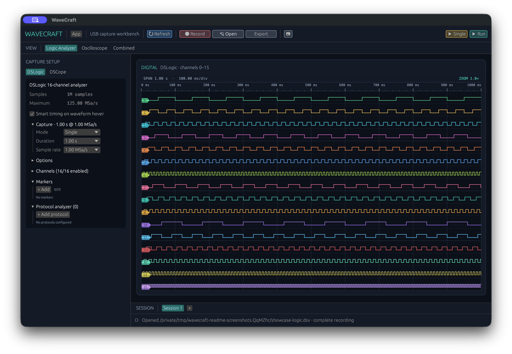
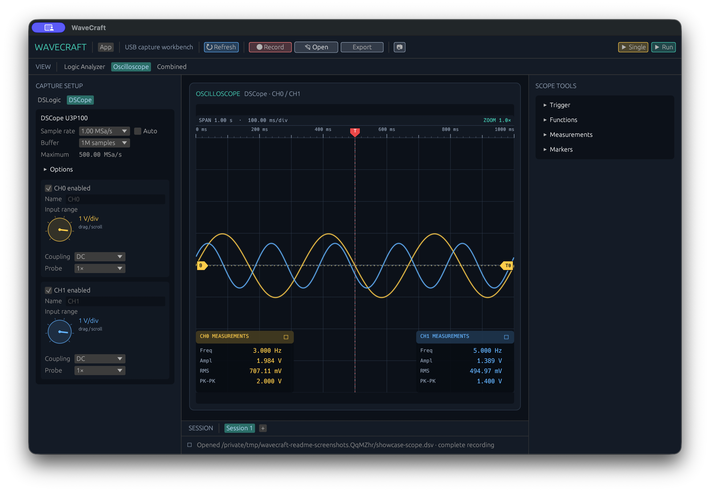
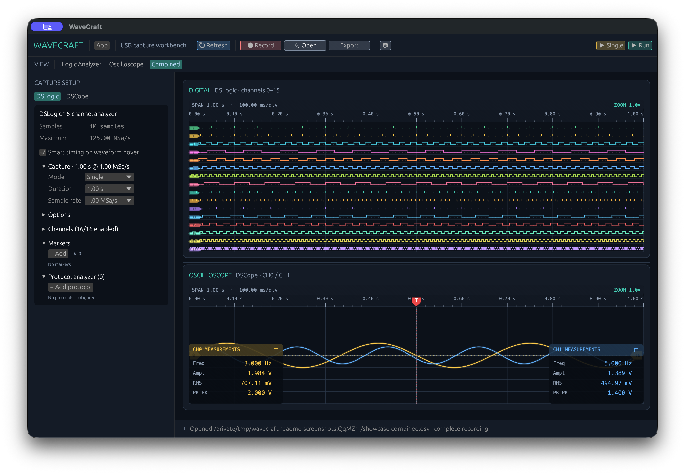

# WaveCraft

A Rust reimplementation of [DSView](https://github.com/DreamSourceLab/DSView) designed to capture from a logic analyzer and an oscilloscope concurrently.

## Application views

### Logic Analyzer (LA)



### Oscilloscope (OSC)



### Combined view



## Release packages

WaveCraft publishes one universal macOS package that runs natively on Apple
Silicon and Intel Macs:

| Platform | Release package | Minimum system |
| --- | --- | --- |
| macOS on Apple Silicon or Intel | `wavecraft-macos-universal.zip` | macOS 11 |
| Linux on x86-64 | `wavecraft-linux-x86_64.tar.gz` | glibc 2.35 (Ubuntu 22.04 or equivalent) |
| Windows on x86-64 | `wavecraft-windows-x86_64.zip` | Windows 10 |

The universal macOS package contains native ARM64 and x86-64 executables, so it
does not require Rosetta on Apple Silicon. Linux releases are built on Ubuntu
22.04 instead of installing another glibc on a newer runner. Windows releases
statically link the MSVC C runtime, so a separate Visual C++ Redistributable
installation is not required.

## Terminology

In project discussions and feature requests, these abbreviations are used:

- **LA** — Logic Analyzer
- **OSC** — Oscilloscope

## Current milestone

The repository contains a working vertical slice of the new capture engine:

- independent capture workers for every instrument;
- a shared monotonic timeline across workers;
- typed logic, oscilloscope, and signed 8-bit complex IQ sample batches;
- a receive-only HackRF One adapter with runtime-loaded `libhackrf`, bounded IQ
  streaming, stable serial selection, and validated RF settings;
- device-independent RF channelization and incremental binary FSK demodulation
  with source-sample ranges preserved across arbitrary IQ batch boundaries;
- coordinated cancellation and worker cleanup;
- simulated instruments and a CLI demonstrating simultaneous capture;
- capture support for the complete upstream DSLogic profile matrix, including
  legacy 16-channel models and DSLogic U3Pro32;
- finite one- or two-channel capture from DSCope U3P100 with configurable sampling and
  per-channel front-end settings;
- concurrent physical capture from one DSLogic and one DSCope on a shared timeline;
- a native desktop capture workbench with synchronized, interactive waveform views;
- logic timing tools and oscilloscope measurements, markers, math, FFT, and XY views;
- time-aligned I²C and SPI byte decoding in dedicated logic-analyzer rows;
- versioned, lossless full-capture recording from the GUI and CLI;
- Saleae Logic 2 `.sal` import and export.

Broader DSCope sample-rate validation, the external protocol-decoder plugin
host, and versioned automation scenarios are the next milestones.

The required end state includes a cross-platform decoder plugin system. SPI
and I2C are first-party decoders, while third-party decoders will run through a
versioned out-of-process protocol so they can be implemented independently in
Rust, Python, or another language without sharing the application's native ABI.
Decoded events remain aligned to source sample ranges and the shared capture
timeline.

Hardware discovery, configuration, capture, and recording are controllable
without the GUI. The CLI provides stable JSON/NDJSON output and complete raw
capture recording suitable for `subprocess` automation, and the first-party
Python client wraps that contract. The recording path receives every captured
frame and is independent of the GUI's bounded waveform display cache. A local
service API can later reuse the same application command layer for long-lived
workflows; automation never depends on parsing human-readable status text.

USB discovery, probing, and FPGA preparation cover all 22 unique DSLogic and
DSCope USB profiles from the upstream driver (`2a0e:0001` through the current
PGL12 revisions at `2a0e:0035`). DSLogic acquisition supports the complete
logic-analyzer matrix, including U3Pro32's extended settings and 32-channel
library API. DSCope acquisition currently uses the calibrated U3P100 driver;
the other DSCope models are discoverable, probeable, and preparable with their
model-specific resources. Discovery is read-only; preparation and capture
commands perform the state-changing operations.

The device listing reports the negotiated USB link speed. USB 3 SuperSpeed is
recommended for U3 models, so they show a reduced-performance warning on USB 2
HighSpeed. HighSpeed is optimal for U2Pro16; slower links are unsupported.

The hardware probe validates descriptors, claims interface 0, and reads firmware
and FPGA status. A bounded, idempotent FPGA loader can configure each model from
the original GPL-compatible bitstream resources. DSLogic and DSCope finite
capture use the same device-independent `CaptureSource` interface as the
simulators.

## Use the command-line application

Install Rust 1.79 or newer, then run:

```sh
cargo run -p wavecraft-cli -- 2
cargo run -p wavecraft-cli -- list
cargo run -p wavecraft-cli -- probe
cargo run -p wavecraft-cli -- load-fpga resources/fpga
cargo run -p wavecraft-cli -- prepare resources/fpga
cargo run -p wavecraft-cli -- capture-logic resources/fpga 1
cargo run -p wavecraft-cli -- capture-scope resources/fpga
cargo run -p wavecraft-cli -- capture-usb resources/fpga
cargo run -p wavecraft-cli -- capture-usb resources/fpga --output capture.dsv
cargo run -p wavecraft-cli -- capture run --device <usb-connection-id> \
  --resource-directory resources/fpga --sample-rate 1000000 \
  --samples 65536 --channels 0,1,2,3 --output capture.dsv --events ndjson
cargo run -p wavecraft-cli -- capture run --device <dscope-connection-id> \
  --resource-directory resources/fpga --sample-rate 1000000 \
  --samples 100000 --channels 0,1 --output scope.dsv --events ndjson
cargo run -p wavecraft-cli -- inspect capture.dsv
cargo run -p wavecraft-cli -- simulate 1 --output simulated.dsv
```

Here `<resource-directory>` contains the complete set of 25 `.bin` and `.fw`
files shipped by the original DSView application. Unmodified copies are
included under `resources/fpga`; only preparation and hardware-capture commands
need them. The file inventory and SHA-256 hashes are documented in
`resources/fpga/README.md`.

`list` performs read-only discovery. `probe` opens each supported instrument,
validates its interface and bulk endpoints, reads the firmware version, and
reports the FPGA hardware status through a reusable claimed-device transport.
It also verifies that interface 0 can be claimed and released. It does not
upload firmware or FPGA data and does not start acquisition.

`load-fpga <resource-directory>` loads the model-specific bitstream only when
the device reports that its FPGA is not configured. The loader validates the
raw Xilinx header, bounds every status wait, checks exact transfer lengths, and
restores safe control-line values if configuration fails.

`prepare <resource-directory>` performs the complete idempotent initialization
path and requires compatible firmware `2.x`, a configured FPGA, and HDL version
`0x0e`. A successful result means the instrument is ready for acquisition.

`capture-logic <resource-directory> [seconds]` prepares the first connected
DSLogic analyzer and performs a finite, trigger-free stream capture at 1 MHz.
The driver selects legacy or ADF4360 clocking, 512-byte or 1 KiB headers,
model-specific buffer/rate limits, threshold encoding, and security challenges.
U3Pro32 uses its extended trigger block and supports a 32-channel mask through
`DsLogicCaptureConfig::with_enabled_channels_32`. Wire data is transposed from
channel-major 64-sample blocks into typed `LogicBatch` frames.

`capture-scope <resource-directory>` prepares the first connected DSCope
U3P100 and performs a finite two-channel capture at 1 MHz with 1 V/div scaling.
The driver configures the 1 GHz front-end clock and ADC, validates and applies
each channel's factory VGA and offset calibration from flash, queues both USB
reads before starting acquisition, validates the trigger header and measurement
footer, and emits typed `ScopeBatch` frames. The device-reported valid length is
authoritative and can be smaller than the requested one-million sample buffer.

`capture-usb <resource-directory>` prepares the first supported DSLogic analyzer
and the first connected DSCope U3P100. Each worker initializes and arms its
device independently, then waits at a failure-safe gate immediately before
issuing the hardware start command. The command reports per-device frame and
sample totals, voltage ranges, timelines, and the observed software start skew.
This skew is not a hardware synchronization guarantee; an external trigger or
clock is still needed for exact sample alignment.

All capture commands accept `--output <capture.dsv>`. The lossless recording
contains every logic and scope sample received by the capture session, plus
device descriptors, frame sequences, shared-timeline timestamps, capture
metadata, source errors, and a completion footer. Frames are written
incrementally with CRC-32 checksums, so recording memory stays bounded and
truncated or corrupted files are rejected. Existing files are never
overwritten. Use `inspect <capture.dsv>` to validate a recording and print its
per-device totals without connected hardware. The format is documented in
`docs/recording-format.md`.

Saleae Logic 2 captures can be converted without connected hardware:

```sh
cargo run -p wavecraft-cli -- import capture.sal capture.dsv
cargo run -p wavecraft-cli -- export capture.dsv capture.sal
```

The GUI's **Open** dialog accepts `.dsv` and `.sal`; **Export** writes the
completed in-memory capture as `.sal`. For a capture that the GUI had to
decimate or trim for display, use the CLI on the original `.dsv` to preserve
every sample. Saleae export carries digital samples, analog voltages, sample
rates, enabled channels, and channel names. Trigger configuration, analyzers,
and WaveCraft-only settings are not representable and are omitted. WaveCraft supports
the current `<SALEAE>` binary version 3 layout and reports other internal
revisions as unsupported because Saleae does not promise `.sal` format
stability.

## Run the desktop application

Install Rust 1.79 or newer and run these commands from the workspace root.
Build an unoptimized development executable with:

```sh
cargo build -p wavecraft-gui
```

Launch the development build directly through Cargo with:

```sh
cargo run -p wavecraft-gui
```

Build the optimized release executable with:

```sh
cargo build -p wavecraft-gui --release
```

The release executable is written to `target/release/wavecraft-gui` on macOS and
Linux, or `target/release/wavecraft-gui.exe` on Windows.

On macOS, build a self-contained, Finder-launchable release application bundle
with:

```sh
./scripts/package-macos.sh
```

Pass `--universal` to build a bundle containing both ARM64 and x86-64 executable
slices. The two Rust targets must be installed before making a universal build:

```sh
rustup target add aarch64-apple-darwin x86_64-apple-darwin
./scripts/package-macos.sh --universal
```

The bundle is written to `target/release/bundle/osx/WaveCraft.app`. Launch it by
double-clicking it in Finder or from a shell with:

```sh
open target/release/bundle/osx/WaveCraft.app
```

Double-clicking `WaveCraft.app` launches the GUI without opening Terminal. The
bundle includes the FPGA resources and the application locates them relative to
its executable. Double-clicking the raw `target/release/wavecraft-gui` Unix binary
will still open Terminal because it is not an application bundle.

Windows builds use the GUI subsystem and therefore do not create a console
window when launched normally. Linux desktop packages should install a
launcher with `Terminal=false`; running the binary from a shell remains useful
for diagnostics.

The application discovers supported USB instruments without blocking the UI,
then prepares and captures from the selected sources concurrently. Instrument
discovery, refresh, and selection are managed from **App → Settings…**. Required
FPGA and firmware resources are selected automatically from the application
bundle or workspace resource directory. The application displays all 16 digital
channels, both calibrated scope channels, per-device sample totals, errors, and
shared-timeline start skew. Independent logic-analyzer and oscilloscope session
tabs retain captured waveforms and their settings while you work with another
session. Capture Setup provides separate DSLogic and DSCope settings tabs while
recording controls remain shared across the synchronized session in a
fixed-width sidebar. DSCope settings provide a common sample rate and capture
buffer plus independent volts/div, AC/DC coupling, probe attenuation, and
hardware enablement for CH0 and CH1. Its
Trigger menu follows the vendor controls for horizontal position, source,
rising/falling edge, holdoff, and noise sensitivity; these settings are encoded
as U3P100 hardware commands and recorded in capture metadata. The toolbar uses
oscilloscope-style **Run/Stop** and **Single** controls. Run continuously re-arms
the hardware: Auto trigger behaves as Auto/Roll, while channel edge sources
replace the displayed waveform after each trigger. Single waits for one trigger
and then stops. Enabled channels support up to 500 MSa/s; disabling either
channel raises the remaining channel's limit to 1 GSa/s. The shared 2M-sample
memory provides up to 1M samples/channel in dual-channel mode or 2M in
single-channel mode. Front-end and trigger changes are applied to the selected
DSCope while idle; existing waveforms retain the settings with which they were
captured. Each input range uses a rotary-style encoder that supports vertical
mouse dragging, the mouse wheel, and arrow keys. Double-clicking a scope encoder
opens its channel color picker; the selected color is shared by the encoder,
trace, offset reference, readout, and trigger indication. Logic Analyzer and
Oscilloscope tabs are available for connected devices or matching data from an
opened capture file. Capture Setup remains available for offline analysis even
when no instrument is connected. The Combined tab appears when both signal
types are available, and Refresh rebuilds the available tab set. Each waveform
expands with the main window; Combined provides a draggable
horizontal divider for adjusting the DSLogic/DSCope height ratio. Logic
waveform storage is bounded at two million activity-preserving buckets whose
stride covers the configured finite or Loop duration, and rendering is further
decimated to the plot width; this display limit does not truncate data written
to a capture file or sent to protocol decoders. DSLogic labels D0–D15 remain visible before
capture, use distinct waveform colors, and open a per-channel color picker when
clicked. Every logic lane includes a persistent dotted `0`-level reference.
Scroll over either waveform to zoom its time axis around the pointer, or drag
the waveform to pan; double-click the waveform to reset it. The logic and
oscilloscope zoom levels are independent in their standalone tabs. The Combined
tab maps both captures onto their overlapping coordinator-time range and uses
one shared viewport, so its grid lines, pan, and zoom remain aligned. Each
waveform always has a top status strip showing time span, time/div, and zoom
ratio, followed by a time ruler that remains visible before capture, tracks the
visible zoom window, and divides every major interval into five minor ticks.
Hovering a logic pulse can show its width, period, frequency, and duty cycle;
persistent logic timing markers snap to nearby edges. The oscilloscope uses a
conventional 10×8 graticule, zero-centered per-channel volts/div scaling,
channel ground markers, configured front-end readouts, and illuminated channel
traces. A draggable trigger-level arrow on the right edge drives the hardware
threshold and its dotted horizontal reference; it uses the selected channel's
color, or a live mix of both channel colors for combined CH0/CH1 triggering
(green with the defaults). Scope tools provide automatic measurements,
amplitude and time markers, channel math, windowed FFT, and a Lissajous XY view.
The protocol-analyzer catalog configures decoder stacks, channel mappings, and
display formats. I²C selections show separate address/direction, data-byte, and
ACK/NACK cells; SPI selections show MOSI/MISO bytes. The dedicated rows remain
aligned with their source samples, and unsupported catalog entries report their
status instead of silently producing no output. The hideable, horizontally
resizable **Decoded Data** pane shares the logic-waveform workspace, groups I²C
bytes into read/write transactions, lists SPI transfers, and renders decoded
UART bytes as human-readable text when ASCII is selected. Clicking a decoded
operation focuses its range in the waveform.

Enable **Record complete capture** and enter a `.dsv` path before starting to
write the full session to disk. The GUI uses the same streaming recorder as the
CLI and refuses to replace an existing file.

The GUI uses native window backends on macOS and Windows and enables both
Wayland and X11 on Linux. Vendored libusb keeps the USB transport consistent
across the three platforms. CI builds and tests the workspace on macOS, Ubuntu,
and Windows, with a separate Rust 1.79 compatibility check.

The USB transport also provides cancellable bulk-IN reads. It polls with a
50 ms timeout, preserves partial transfers reported by libusb, retries timeout
and interrupted operations, and distinguishes cancellation from USB failures.
The opt-in hardware check is:

```sh
cargo test -p wavecraft-usb --test hardware -- --ignored --nocapture
cargo test -p wavecraft-automation --test hardware -- --ignored --nocapture
```

The first command checks cancellable idle USB reads on every supported
instrument. The second prepares and captures from explicitly selected DSLogic
and DSCope devices through the automation contract. Close WaveCraft and DSView
so the instruments are idle before running either command.

HackRF One support is implemented as a receive-only backend crate and loads
`libhackrf` at runtime, so normal builds and tests do not require HackRF host
software. Install current HackRF host tools before using the backend. If the
library is outside the platform search path, set `WAVECRAFT_LIBHACKRF_PATH` to
the complete shared-library path. The opt-in discovery and finite-IQ capture
check is:

```sh
cargo test -p wavecraft-hackrf --test hardware -- --ignored --nocapture
```

Close other HackRF applications before running the check. The generic RF GUI
acquisition controls and provider aggregation are tracked separately from the
backend implementation.

The numeric shorthand (for example, `wavecraft-cli -- 2`) is the simulated
capture duration in seconds.
Run all checks with:

```sh
cargo fmt --all --check
cargo clippy --workspace --all-targets -- -D warnings
cargo test --workspace
```

## Use the Python client

The dependency-free client under `python/` wraps the versioned CLI JSON
contract. Build the CLI and install the local package:

```sh
cargo build --release -p wavecraft-cli
python3 -m pip install -e python
```

Then discover and capture from one exact selected connection:

```python
from wavecraft import WaveCraftClient

client = WaveCraftClient.from_workspace(".")
device = client.list_devices(kind="logic_analyzer", backend="usb")[0]
result = client.capture(
    device_id=device["connection_id"],
    sample_rate_hz=1_000_000,
    sample_count=65_536,
    channels=[0, 1, 2, 3],
    output="python-logic.dsv",
    on_event=lambda event: print(event),
)
print(result["summary"]["recording_path"])
```

`WaveCraftClient` also exposes exact-device probing, DSCope capture through the
same method, live status/progress callbacks, and structured exceptions. See
[`python/README.md`](python/README.md) for details.

## Workspace layout

- `crates/wavecraft-core`: device-independent capture types and concurrency.
- `crates/wavecraft-sdr`: device-independent radio discovery and configuration contracts.
- `crates/wavecraft-hackrf`: runtime-loaded HackRF One discovery and receive-only IQ capture.
- `crates/wavecraft-recording`: native recording plus Saleae `.sal` import/export.
- `crates/wavecraft-sim`: deterministic simulated logic and scope sources.
- `crates/wavecraft-usb`: USB discovery, claimed sessions, control transport, FPGA loading, and DSLogic/DSCope capture.
- `python`: dependency-free selected-device automation client.
- `apps/wavecraft-cli`: simultaneous-capture development harness.
- `apps/wavecraft-gui`: native device selection, capture controls, status, and waveform rendering.
- `docs/architecture.md`: design constraints and planned hardware integration.
- `docs/custom-protocol-yaml.md`: complete authoring reference for custom
  UART, SPI, and I2C protocol YAML files.
- `docs/custom-protocols.md`: custom protocol decoding architecture and future
  direction.
- `docs/recording-format.md`: native `.dsv` framing and Saleae interoperability.
- `docs/automation-and-mcp.md`: proposed CLI, service, SCPI, Saleae API, and MCP automation architecture.
- `docs/saleae-logic-device-support.md`: feasibility and integration paths for Saleae Logic devices (excluding Logic MSO).

The project is licensed under GPL-3.0-or-later to remain compatible with the original DSView codebase.
