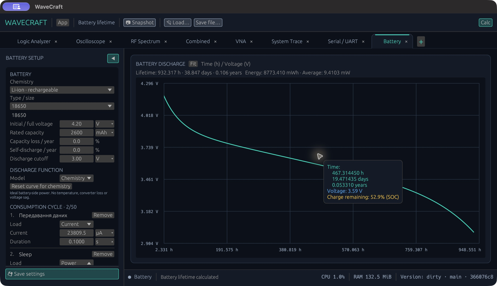

# Shared instrument view pattern

All workspaces use the same instrument chrome, based on the LA/OSC layout.
`apps/wavecraft-gui/src/ui/view_shell.rs` owns visual structure; individual
views own their settings editors, plot painters, and domain actions. This
applies equally to LA, OSC, RF, Combined, VNA, System Trace, Serial, and Battery.

## Components

| Component | Responsibility |
| --- | --- |
| `view_toolbar` | Common application identity, App menu, Snapshot button, toolbar background and spacing; returns Settings and Snapshot requests |
| `workspace_tab_bar` / `workspace_tab` | Scrollable workspace tabs, close buttons, add menu, shared baseline and active accent; the application owns selection, visibility and drag ordering |
| `SetupPanel` | 300-point left panel, heading, typography, constrained scrolling, mandatory collapse/expand and pinned Save settings footer |
| `settings_card` | Dark inset grouping settings sections, with shared width constraints and padding |
| `workspace_panel` | Central background and outer margins |
| `view_card` | Full-height plot/table card with a common outline, corner radius and padding |
| `remaining_plot_rect` | Remaining plot area after a view's header; also usable for snapshot cropping |
| `tools_panel` | Expanded heading/body or collapsed strip beside a plot; returns the body's result |
| `settings_scroll` | Width-constrained scrolling for settings in auxiliary panels |
| `ui/status_bar.rs` | Common bottom status row, connection details, error area and process metrics |

`card_frame` is the lower-level shared outline for content that manages its
own height (for example the reorderable System Trace instruments). Waveform
`waveform_card` composes `view_card` and `remaining_plot_rect`; generic chrome
does not belong in a device-specific or waveform-specific renderer.

Workspace tabs are managed in their strip: **+** offers all views, with already
open views disabled, and **×** closes a tab while keeping at least one open.
Adding a view appends and selects it. Closing a tab retains its instrument state.
The existing global settings persist the open tabs, order and active view
immediately, including compatibility with previously hidden views. Application
Settings contains instrument settings rather than workspace visibility controls.
The add button stays outside the horizontal scroll area so it remains reachable
in a narrow window.

Primary Run/Stop/Single controls occupy the right end of the toolbar. Refresh,
file operations, and instrument-specific actions occupy the left area after
the shared App menu. Use `theme::toolbar_action_button` for their appearance.

## Adding a view

1. Add the view identity and persistence mapping alongside `WorkspaceView`.
2. Supply toolbar, setup, and central-content painters in `ui/`; register them
   with the existing application dispatch. Use the shell functions below.
3. Register the setup panel identity in `ui/setup_panel.rs` and its save behavior
   in `save_setup_settings`. Retain settings, capture state, and workers with their existing application
   owners. Return typed requests through `FrameActions` where applicable.
4. Adapt any local connection status or errors in `active_view_status` in
   `ui/status_bar.rs`. The application paints that area once for every view.
5. Verify common dimensions, message placement and the new view's actions in
   headless egui frame tests; inspect the native view and capture a screenshot.

The composition is intentionally small (illustrative Rust):

```rust,ignore
let toolbar = view_toolbar(context, "Instrument description", self.pending_snapshot.is_none(), |ui| {
    // Refresh and file actions, followed by right-aligned Run/Stop controls.
});
self.settings_open |= toolbar.settings_clicked;
actions.snapshot_clicked |= toolbar.snapshot_clicked;

self.show_setup_panel(context, WorkspaceView::Instrument, actions, |app, ui, actions| {
    settings_card(ui, |ui| {
        // Instrument settings sections; edit app state and emit domain actions.
    });
    // Return availability after edits, including validation of new values.
    settings_are_valid && !app.is_busy()
});

workspace_panel(context, |ui| {
    view_card(ui, |ui| {
        // Title, tabs and optional plot controls.
        let rect = remaining_plot_rect(ui);
        // Paint the instrument's plot in rect.
    });
});
```

## Snapshots

Snapshot belongs to the toolbar template and appears once in every workspace,
including Serial/CSV and System Trace. Disable it while a screenshot request is
pending. The frame dispatch in `paint_central_panel` queues the screenshot after
painting the active view, using that frame's bounds and display scale. Views with
a dedicated plot keep their plot crop; mixed views and tables use their visible
central workspace. Setup panels, toolbars and status messages are excluded.

`finish_pending_snapshot` receives the screenshot, crops it through the shared
image helper, asks for an output directory, and saves a PNG without overwriting
existing snapshots. Status and errors use the common message area. Serial keeps
the imported file name visible alongside snapshot feedback. Do not implement
additional per-view screenshot handlers or duplicate Snapshot buttons.

All left panels use `show_setup_panel` in `ui/setup_panel.rs`. This adapter
connects the visual template to `WorkspaceViewLayout` and `FrameActions`.
`SetupPanel::show` always requires an open flag and always renders the same
`Save settings` footer below the scroll area. Views supply only their body and
return whether the edited values may be saved; they do not paint save controls.
The footer remains visible even when the settings body overflows or sections
are collapsed.

Collapse state is independent for each workspace and survives restarts through
`GlobalSettings::collapsed_setup_views`. Older settings files default to open
panels. Settings and captured data stay intact across collapse/expand.
Panel IDs remain distinct per workspace to isolate scrolling and interaction.

The adapter emits `FrameActions::save_setup_settings_view`. The frame applies
that request through `save_setup_settings`, preserving the existing per-type
capture profiles. Combined saves LA and OSC profiles together in one write;
Serial saves `global.serial`, retaining compatibility with existing settings
files and its automatic saves. Successful explicit saves and failures use the
common message area.

## Status and errors

The bottom area has one shared visual hierarchy: view identity and operation
status, optional connection details, and process metrics. Errors appear below
that row in a bounded scrolling area, wrap to the available width, and can be
selected and copied with Cmd+C / Ctrl+C, without a separate copy button. Duplicate errors are shown once. Global operation
errors remain visible alongside an active view's local errors.

Serial contributes its own running/disconnected status and error. System Trace
contributes connection/recording state and connection errors. VNA contributes
discovery errors. Existing capture/file operations continue to supply the
application status and error. Switching views does not erase backend state.

Do not place operational errors or connection messages inside a setup panel,
toolbar, or plot. They must remain visible when settings are collapsed. Local
plot annotations, data quality counters, empty-state guidance and actionable
confirmation dialogs still belong with their content; they are not substitutes
for the bottom operation/error area.

All informational labels and tooltips must support text selection and native
keyboard copying. The global theme enables `selectable_labels`; shared message
labels explicitly remain selectable. Do not disable selection in local styles
or add dedicated message-copy controls.

## Numeric parameter input

Numeric parameters use keyboard/manual input by default. Adding horizontal
pointer dragging, value scrubbing, or a slider to change a parameter requires an
explicit user request for that control. Use the shared `ui/manual_value.rs`
`ManualValue` widget for compact fields; it retains typed editing, numeric bounds,
formatting, and the existing fixed-width layout without changing values on drag.
Battery uses it for battery parameters, degree and coefficients, measured-table
points, and consumption patterns. RF numeric fields reuse the same component.

## Changes to the pattern

Extend the shell for new layout capabilities and migrate affected views to it.
Do not start another view-local `instrument_frame`, toolbar header, or settings
panel frame. Keep the shell free of application state, capture operations,
backend imports and worker ownership. The related repository-wide rule lives
in `AGENTS.md`; broader ownership work is described in `gui-modularization.md`.


## Battery lifetime workspace

Battery uses the shared toolbar, setup adapter, settings card, central view card,
Snapshot path, and bottom status messages. `Calc` occupies the primary acquisition
position on the right; Load and Save file export the complete analysis as a
versioned `wavecraft-battery` JSON document. The pinned Save settings footer saves
the edited parameters into the application's global settings. Editing parameters
retains the previous result with a visible recalculation reminder; loading a file
clears the old result. Failed loads retain the current analysis.



[Example analysis](examples/battery-analysis.json) contains a Li-ion 18650 model
and a repeating 100 mW / 100 ms, 1 mW / 900 ms consumption cycle. The native view
supports wheel zoom on time, Ctrl/Cmd + wheel zoom on both axes, dragging to pan,
and Fit by button or double-click. Axis labels and hover readouts are selectable.

### Curve representation and approximation

`src/battery.rs` owns the calculation without UI or hardware dependencies.
All curves express `V(x) = V_initial × f(x)`, with `x` the fraction of rated
capacity already discharged, from 0 to 1. The voltage input is the **initial/full
voltage**, rather than nominal voltage. Cutoff is independent of the discharge
function: increasing cutoff stops at an earlier point on the same curve.

The chemistry defaults use a bounded empirical exponential/linear/knee shape:

```text
f(x) = 1 - (1 - V_end / V_full) × g(x)
g(x) = a × (1 - exp(-20x)) / (1 - exp(-20))
       + b × x + (1 - a - b) × x^k
```

`V_full`, `V_end`, `a`, `b`, and `k` select an illustrative shape per chemistry;
these coefficients are engineering starting points, not manufacturer fits or a
universal standard. Size is a freely editable label and does not silently change
capacity or pack voltage. Actual voltage, capacity, and cutoff must describe the
chosen cell or pack. For a pack, enter its aggregate voltage and capacity.

For future measured curves, start with a **degree 5 polynomial** on normalized
`x ∈ [0,1]`, keeping coefficients in ascending power order. This is a practical
starting recommendation, not an assurance of fit quality: compare residuals and
check monotonicity, especially near the end knee. Degrees 1–5 are editable.
The initial polynomial is a monotone seed, not a fit of the default curve.

The measured-table option already accepts 2–256 ordered `[x, V/V_initial]` points
with linear interpolation, retaining exact samples for future fitting. A later
monotone cubic (PCHIP) interpolator would preserve knees without high-degree
polynomial oscillations. Tabulated voltage as a function of charge state is also
an established modeling approach; see the [MathWorks table-based battery model](https://www.mathworks.com/help/simscape-battery/ref/batterytablebased.html).
The current polynomial is checked over a 4096-interval grid; table ordering and
monotonicity are checked at every knot.

### Load and lifetime calculation

The 1–50 patterns execute sequentially and repeat. Each has an editable name
(up to 128 characters), retained in Save settings and JSON profiles. Older files
without names remain valid and show a numbered name placeholder. Names do not
affect the calculation. Each pattern holds either power or current constant and
refers to the battery side. Durations are floating-point values.
Zero-power sleep is supported. An entirely zero-energy cycle requires positive
self-discharge and a voltage cutoff reached before zero remaining charge.
The solver locates cutoff by bisection, integrates `V(q) dq` in mWh over up to
4096 intervals, then inverts the repeating load's cumulative energy to obtain
time. It skips whole cycles algebraically and resolves the final partial pattern,
so a low-duty-cycle device does not require billions of time steps. At an exact
energy boundary it stops at the consuming pattern, before a trailing sleep.
The plotted curve is a bounded sampled envelope; individual short pulses may
not be visually resolved across a long lifetime.

The result reports hours, days, years, delivered mWh, average cycle mW, and whether
cutoff or rated capacity ended the run. Delivered energy excludes energy lost to
aging and self-discharge.

### Display units, current loads, and cursor readouts

Unit menus remain outside the equal-width numeric fields. The fields and unit
menus have fixed widths, so changing the selected unit does not shift the rows.
They support:

| Quantity | Units |
| --- | --- |
| Pattern duration | ns, ms, s, min |
| Initial/cutoff voltage and graph voltage | mV, V |
| Constant current | µA, mA, A |
| Constant power | µW, mW, W |
| Battery capacity | mAh, Ah |

Voltage and capacity menus select the battery display units; each pattern retains
its own time, power, and current display units. The solver and saved numeric
values retain canonical V, mAh, mW, mA, and ms. Switching a unit only changes
presentation, preserves the physical quantity exactly, and does not invalidate
an existing calculation. Names and units persist with the analysis.

Each pattern's Load menu selects constant power or constant current. Switching
modes initializes the other quantity using the initial battery voltage. During
calculation, current-mode power follows `P = I × V` as voltage changes; it is
not treated as a fixed initial-power approximation. Mixed current/power cycles,
partial patterns, aging, and self-discharge use the same charge-domain solver.
Constant-current files export as version 2 so older readers reject unsupported
load semantics; version 1 profiles remain supported with V/mAh/mW/ms defaults.

The graph cursor reports hours, days, and years on separate indented lines under
one Time heading, voltage in the selected unit (two decimal places for V, whole
mV), and remaining state of charge to one decimal place in percent. Voltage is
blue and SOC is yellow. SOC comes from the solver's sampled charge
coordinate, not a linear estimate from elapsed time or voltage. It is relative
to the capacity available after calendar aging. A voltage cutoff may leave a
positive SOC. The displayed year uses the same 365.25-day definition as aging.

### Annual aging and self-discharge

The setup panel has two independent parameters, both defaulting to **0%/year**:

- **Capacity loss / year**: calendar aging reduces available capacity as
  `C(t) = C_initial × (1 - aging/100)^(t/8766)`.
- **Self-discharge / year**: loss of the remaining charge, including during
  zero-power sleep. With no load, `SOC(t) = (1 - self_discharge/100)^(t/8766)`.

Rates are finite values from 0 up to, but excluding, 100%; 0 disables the effect.
For example, 10%/year retains 90% after one year and 81% after two. A model year
is 365.25 days (8766 hours). The calculation starts from the entered full battery
at time zero; the rates describe future losses during the modeled lifetime.
These are user-selected constant-rate approximations, not chemistry-calibrated
aging predictions.

With `H(t)` the remaining capacity fraction, `S` remaining state of charge,
`k = -ln(1-aging/100)/8766` and `s = -ln(1-self_discharge/100)/8766`, the model is:

```text
H(t) = exp(-k t)
dS/dt = -P(t) / (C_initial × V(1-S) × H(t)) - s × S
```

Aging alone does not act as a charge drain during sleep. Self-discharge reduces
SOC even with no load. Constant-power cycles without self-discharge use
analytical energy inversion. For current-mode patterns or self-discharge, the
solver uses 4096 charge intervals, holds voltage at each interval's endpoint mean, and integrates
the resulting linear equation using exponential cycle sums and bounded root
searches. Pattern order, sleep, and partial cycles remain part of the model;
whole cycles are not simulated one by one. Pure shelf discharge is solved
analytically; it reaches a positive-SOC voltage cutoff in finite time, while
exactly zero charge is approached asymptotically.

Both rates participate in stale-result detection, explicit Save settings, and
portable JSON profiles. Missing fields in older files default to 0, preserving
previous calculations. Tests include constant-voltage analytical solutions,
combined losses, cutoff during sleep, pure shelf discharge, invalid rates,
legacy files, and settings round trips.

Temperature, converter losses, current-dependent capacity (including Peukert
effects), recovery, and internal-resistance voltage sag remain outside this
model and require additional measured parameters.

JSON import validates the format/version, finite values, curve domain, and load
limits before changing the view. Reads are capped at 1 MiB, and floating-point
values round-trip without losing coefficient precision. Tests cover analytical
constant and declining voltage cases, duration-weighted loads, partial cycles,
sleep, every chemistry/curve combination, invalid data, JSON round trips,
workspace migration/persistence, graph interactions, and the shared shell.
